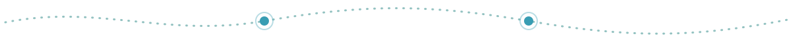
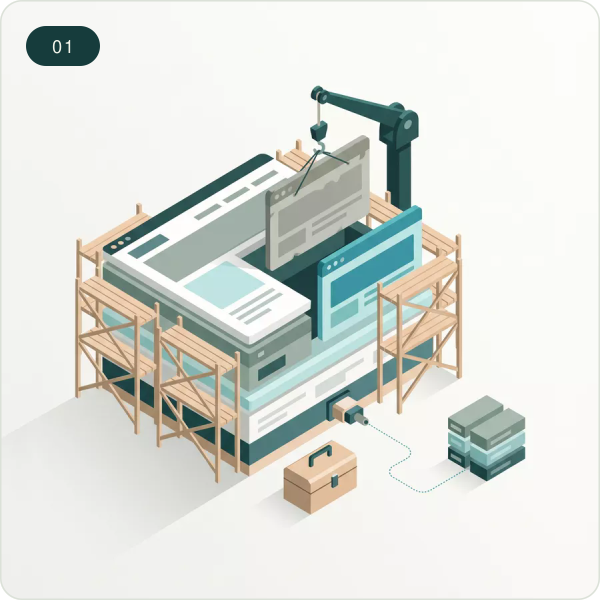
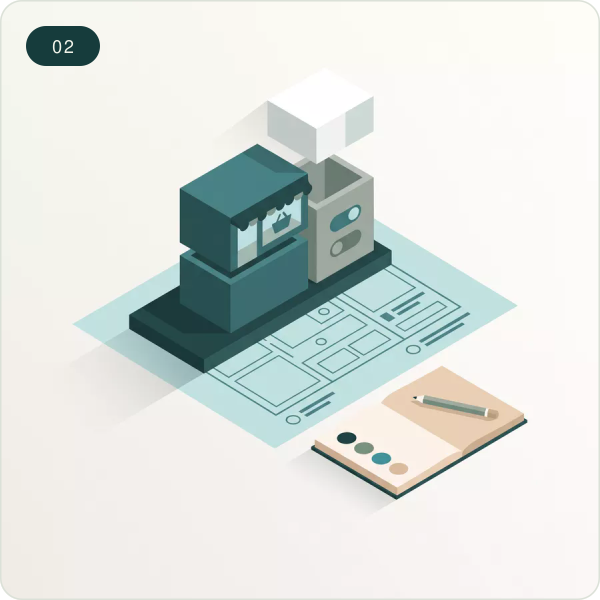
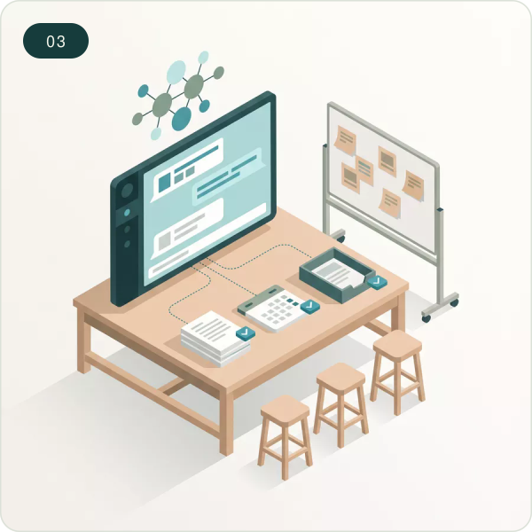
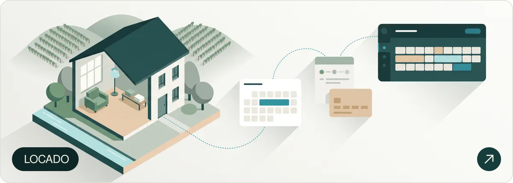
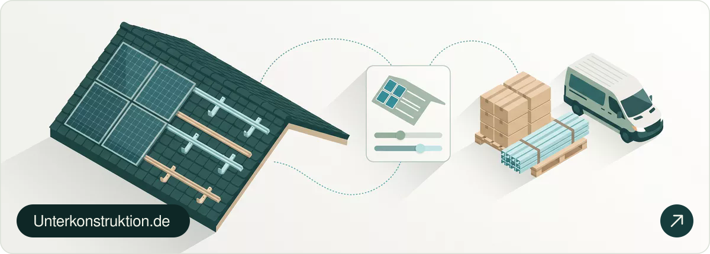
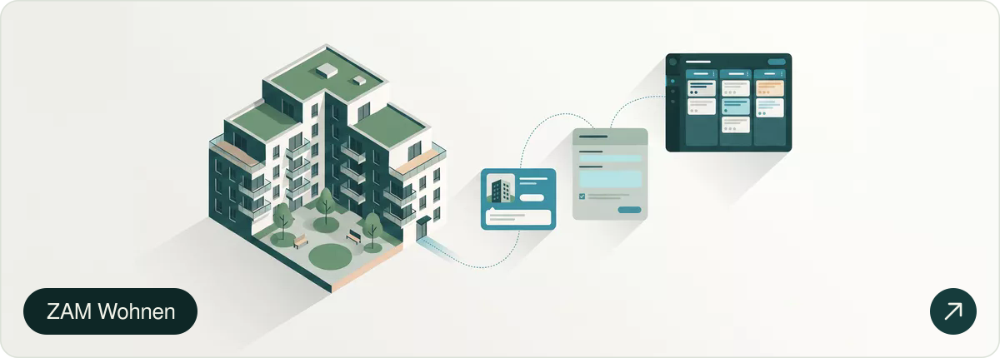
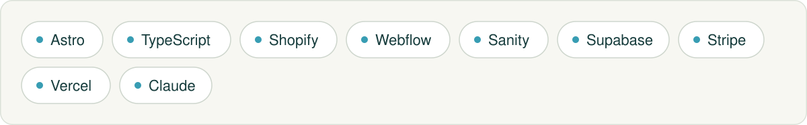

<a href="README.md">Deutsch</a> · <b>English</b>

ABOUT ME

### Personally involved. *From day one.*

I'm Til Kams, founder of [NEWAVE Forward](https://www.newaveforward.de) in Berlin. I turn challenges into digital solutions by combining consulting, design and development, from the first idea to a working system. You work directly with the person who understands your problem and builds your solution.

WHAT I DO

### Where are you right now? *That's where we start.*

<table>
<tr>
<td width="33%" valign="top">

<b>Moving existing projects forward</b>

Project takeover and assessment. Relaunches, stabilization and integrations. Ongoing consulting and development.

</td>
<td width="33%" valign="top">

<b>Building something new</b>

Strategy, concept and design. Websites, online shops and custom software. Development and rollout.

</td>
<td width="33%" valign="top">

<b>Making AI useful</b>

Hands-on training and workshops. AI consulting and automation. Custom AI applications.

</td>
</tr>
</table>

PROJECTS

### Your business is unique. *So is your digital solution.*

**LOCADO** · HOSPITALITY & CUSTOM DEVELOPMENT 
A home for a while. Booked directly, no platform in between. A bilingual website, a custom checkout with Stripe and a live connection to the channel manager Smoobu, plus automated emails and a team area for daily operations. 
Astro · Stripe · Smoobu · <a href="https://www.newaveforward.de/projekte/locado/">View project (German)</a>

**Unterkonstruktion.de** · COMMERCE & CUSTOM DEVELOPMENT 
A complex product. A well-designed path to purchase. A Shopify store with its own solar configurator and custom shipping logic for parcels, pallets and long goods. 
Shopify · Configurator · Shipping integration · <a href="https://www.newaveforward.de/projekte/unterkonstruktion/">View project (German)</a>

**ZAM Wohnen** · REAL ESTATE & DIGITAL PROCESSES 
From first interest to a connected rental process. A website as the entry point, a custom application flow and a dedicated CRM behind it, all the way to the key handover. 
Webflow · Application flow · Custom CRM · <a href="https://www.newaveforward.de/projekte/zam-wohnen/">View project (German)</a>

**More projects:** [Matari Solar](https://www.newaveforward.de/projekte/matari-solar/) · [MOWE Wine Space](https://www.newaveforward.de/projekte/mowe-wine-space/) · [Overseas Projects](https://www.newaveforward.de/projekte/overseas-projects/) · [Recht Logistik](https://www.newaveforward.de/projekte/recht-logistik/) · [UBRE](https://www.newaveforward.de/projekte/ubre/) · [Vinomic](https://www.newaveforward.de/projekte/vinomic/)

AI IN MY OWN WORK

### I use what I *teach.*

I use my own AI-powered CRM every day. It sorts incoming inquiries and drafts replies, which I review and approve. My AI training sessions grow out of this practice.

TOOLS

CONTACT

### What would you like to *move forward?*

Let's talk about your project: [til@newaveforward.de](mailto:til@newaveforward.de) · [newaveforward.de](https://www.newaveforward.de) (in German) 
Based in Berlin, working with companies across Germany.

