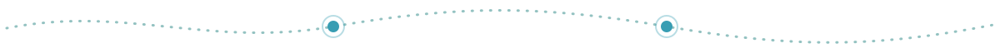
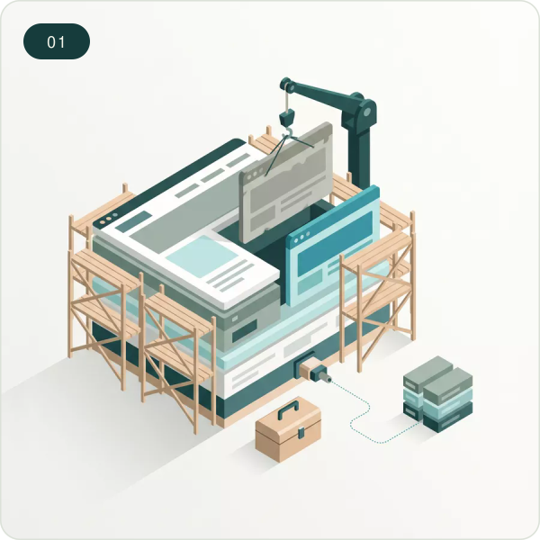
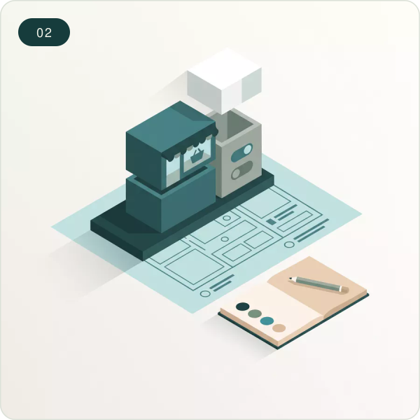
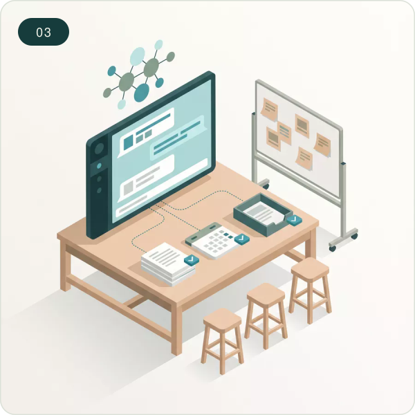
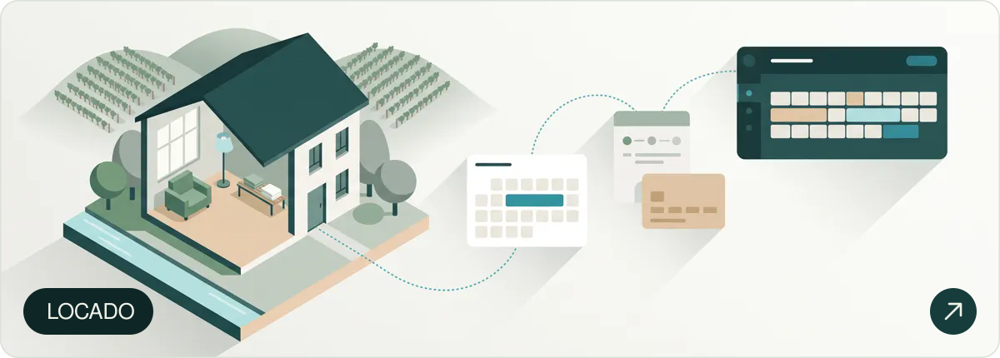
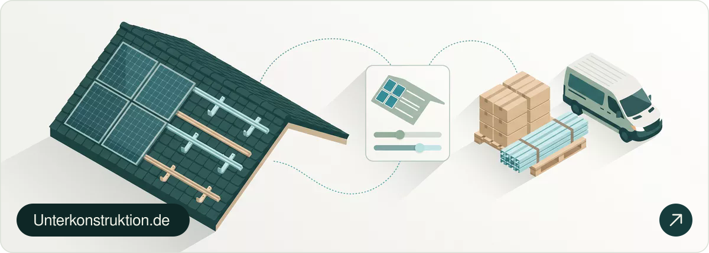
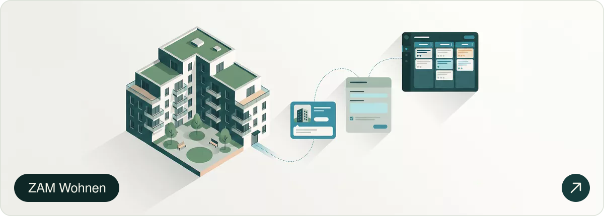
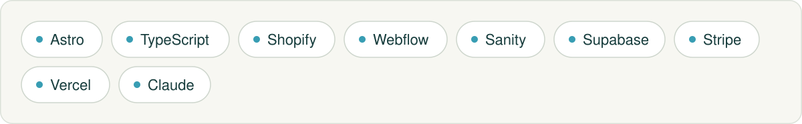

<b>Deutsch</b> · <a href="README.en.md">English</a>

ÜBER MICH

### Persönlich involviert. *Von Anfang an.*

Ich bin Til Kams, Gründer von [NEWAVE Forward](https://www.newaveforward.de) in Berlin. Aus Herausforderungen werden digitale Lösungen: Ich verbinde Beratung, Design und Entwicklung, von der ersten Idee bis zum funktionierenden System. Sie arbeiten direkt mit der Person, die Ihre Herausforderung versteht und Ihre Lösung entwickelt.

WAS ICH MACHE

### Wo stehen Sie gerade? *Hier setzen wir an.*

<table>
<tr>
<td width="33%" valign="top">

<b>Bestehendes weiterbringen</b>

Projektübernahme und Bestandsaufnahme. Relaunch, Stabilisierung und Schnittstellen. Laufende Beratung und Weiterentwicklung.

</td>
<td width="33%" valign="top">

<b>Neues aufbauen</b>

Strategie, Konzeption und Design. Websites, Shops und individuelle Systeme. Entwicklung und Einführung.

</td>
<td width="33%" valign="top">

<b>KI nutzbar machen</b>

Praxisnahe Schulungen und Workshops. KI-Beratung und Automatisierung. Individuelle KI-Anwendungen.

</td>
</tr>
</table>

PROJEKTE

### Ihr Unternehmen ist individuell. *Ihre digitale Lösung auch.*

**LOCADO** · HOSPITALITY & INDIVIDUELLE ENTWICKLUNG 
Ein Zuhause auf Zeit. Direkt gebucht, ohne Plattform dazwischen. Zweisprachige Website, eigener Checkout mit Stripe und eine Live-Anbindung an den Channel-Manager Smoobu, dazu automatische Mails und ein Teambereich für den Betrieb. 
Astro · Stripe · Smoobu · <a href="https://www.newaveforward.de/projekte/locado/">Projekt ansehen</a>

**Unterkonstruktion.de** · COMMERCE & INDIVIDUELLE ENTWICKLUNG 
Ein komplexes Produkt. Ein durchdachter Weg zum Kauf. Shopify-Shop, eigener Solar-Konfigurator und individuelle Versandlogik für Paket, Palette und Langgut. 
Shopify · Konfigurator · Versand-Integration · <a href="https://www.newaveforward.de/projekte/unterkonstruktion/">Projekt ansehen</a>

**ZAM Wohnen** · IMMOBILIEN & DIGITALE PROZESSE 
Vom ersten Interesse zum verbundenen Vermietungsprozess. Eine Website als Eingang, eine individuelle Bewerbungsstrecke und ein eigenes CRM dahinter, bis zu Übergabe und Schlüssel. 
Webflow · Bewerbungsstrecke · Individuelles CRM · <a href="https://www.newaveforward.de/projekte/zam-wohnen/">Projekt ansehen</a>

**Weitere Projekte:** [Matari Solar](https://www.newaveforward.de/projekte/matari-solar/) · [MOWE Wine Space](https://www.newaveforward.de/projekte/mowe-wine-space/) · [Overseas Projects](https://www.newaveforward.de/projekte/overseas-projects/) · [Recht Logistik](https://www.newaveforward.de/projekte/recht-logistik/) · [UBRE](https://www.newaveforward.de/projekte/ubre/) · [Vinomic](https://www.newaveforward.de/projekte/vinomic/)

KI IM EIGENEN ALLTAG

### Ich nutze, was ich *schule.*

Mein eigenes CRM mit KI nutze ich jeden Tag. Es ordnet neue Anfragen ein und bereitet Antwortentwürfe vor, die ich prüfe und freigebe. Aus dieser Praxis kommen meine KI-Schulungen.

WERKZEUGE

KONTAKT

### Was möchten Sie *weiterbringen?*

Projekt besprechen: [til@newaveforward.de](mailto:til@newaveforward.de) · [newaveforward.de](https://www.newaveforward.de) 
Von Berlin aus, für Unternehmen in ganz Deutschland.

